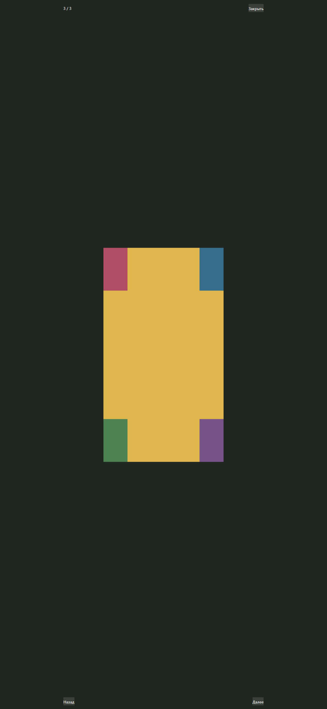
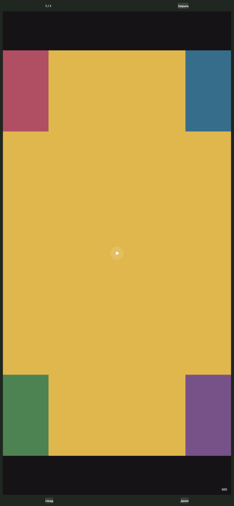

# MEMOLY-FULLSCREEN-CAROUSEL-SWIPE-FIX

Date: 2026-10-17. Status: APPROVED technical review; PR awaiting owner review, not merged or deployed.
Lead: Codex. Implementation: GPT-6 Luna, high (requested orchestration configuration); independent review: fresh GPT-6 Luna, high.
Branch: `fix/memoly-fullscreen-carousel-swipe`.
Worktree: `D:/codex/TG_OurMemoriesDevBot/OurMemoriesDevBot/.worktrees/memoly-fullscreen-carousel-swipe`.
Base: `e383d79269a3595f4c6cabedf167335aea042cf3`; publication head is recorded in PR metadata/body.

## Root cause and minimal fix
The feed Embla carousel and fullscreen viewers have different gesture owners. Trusted Chromium CDP single-finger input advanced the unchanged PhotoSwipe album 1/3 -> 2/3, while the same swipe over a mixed fullscreen photo left its counter at 1/3. The regression failed before production edits because MixedMediaViewer only handled buttons and keyboard navigation.

MixedMediaViewer now recognizes local one-finger horizontal gestures on the media surface and calls its existing bounded navigate function. Movement below 48px, predominantly vertical motion, multitouch, cancellation and interactive control targets are rejected. A gesture is consumed once; successful button/key navigation clears pending gesture state. CSS only declares `pan-y pinch-zoom` on the fullscreen media area; image sizing and contain presentation are unchanged. Existing navigation pauses video and keyed media cleanup releases its source. Private access, object URL ownership and cache code are unchanged.

PhotoSwipe gestures already worked. A settled outward swipe at its first item exposed default wraparound (1/3 -> 3/3); only `loop: false` was added. Its native gesture/zoom implementation remains in use.

## Changed paths and ownership
- `webapp/src/features/feed/FeedPage.tsx`: mixed gesture navigation and PhotoSwipe loop option.
- `webapp/src/features/feed/presentation/memoly-feed.css`: gesture policy only.
- `webapp/e2e/fixed-carousel.harness.tsx`: query-specific synthetic 3-photo and photo/video/photo fixtures; default fixture unchanged.
- `webapp/e2e/fullscreen-swipe.spec.ts` and `.playwright.config.ts`: focused regression, isolated Vite port 5197.
- This report, task plan, and two synthetic screenshots under `docs/mvp/review/evidence/fullscreen-carousel-swipe/`.

No backend, schema/migration, shared contract, lockfile, dependency, release-gate or messenger-adapter changes. PRs #176/#177 were not modified. Scope: MAX and Web/PWA.

## Verification evidence
| Command | Result |
|---|---|
| `bun install --frozen-lockfile` | Exit 0; 864 packages installed, manifests/lock unchanged |
| Focused command before production fix | Exit 1; mixed counter remained 1/3 instead of expected 2/3 |
| `bun run --cwd webapp e2e --config e2e/fullscreen-swipe.playwright.config.ts` | Lead final run: 3 passed, 23.6s, exit 0 |
| `bun run --cwd webapp e2e --config e2e/fixed-carousel.playwright.config.ts` | Existing baseline and post-fix worker run: 1 passed, exit 0 |
| `bun run typecheck:webapp` | Final exit 0 |
| Targeted ESLint on FeedPage.tsx and all changed TS/TSX test files | Exit 0 |
| `git diff --check` | Exit 0 |

Fresh worktree typecheck initially lacked generated Prisma client; `bun run --cwd backend prisma:generate` generated it locally (exit 0), then final typecheck passed. No database/migration action was performed. A transient type error while the regression spec was being refined was corrected before the final stable run.

Chromium projects: iPhone 13 and Pixel 7 profiles, actual trusted CDP touch input and `hasTouch`, viewport 390x844. Album: both directions, first/last limits, counter, feed dot and reopen at second item. Mixed: photo -> video -> photo, direct gestures on image/video, first/last limits, counter, second-item opening, synchronized feed/reopen, buttons and keyboard. Jitter, vertical-first motion, cancellation and multitouch do not navigate. Touch on seek and pause controls does not navigate; seek still changes position. Video playback advances before a swipe away, then the old element is paused with null src, empty buffers and NETWORK_EMPTY.

WebKit iPhone profile: synthetic touch events exercise mixed navigation, rejected gestures, bounds and reopen; PhotoSwipe checked with keyboard. Video playback lifecycle was unavailable in that WebKit setup and was verified only in Chromium. This is not evidence of native Safari touch or a real MAX host. Physical iPhone/Android verification remains unconfirmed.

Lead inspected actual diff and photo screenshot (all four synthetic corner markers visible, contain fit). Additional harness DOM/console inspection at port 5198 showed meaningful feed content and no framework overlay; the only console error was the standalone harness favicon 404.

## Independent review
One fresh read-only reviewer inspected the whole active change against original requirements after deterministic checks. Verdict: production_ready, no P0/P1/P2 or other findings. No review fix pass was needed. Its noted limitation was physical iPhone/native WebKit touch verification. Review applies to unchanged production/test source included in this PR.

## Screenshots
Synthetic test materials only; no family data.

## Delivery limits
No full application audit or full release suite was run. `bun run verify:local` remains mandatory before a future merge/publication to main; this task prepares a separate PR only. No merge, deploy, tag, real invitation or production data action was performed.
Rollback: revert this PR's code; no data migration is involved. Residual acceptance: physical device/MAX host touch and pinch behavior, and native WebKit video lifecycle.
