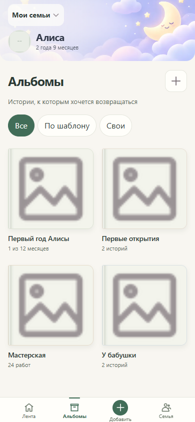
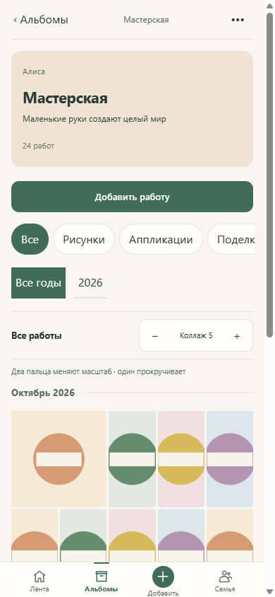

# MEMOLY-ALBUMS visual review evidence

Reference: PR #217, source `1ee80569adab464175c3393fd51182f13ef7b5d2`.
Captured from the real React `App`/`AlbumsPage` components at runtime source
`79c50b66bdd5c9c7a394031de9d27b433ee4367b`, Chromium viewport390×844.
The later release-guard change does not alter those production frontend inputs.

These screenshots use the isolated selected-family test transport and neutral
synthetic materials. They demonstrate rendered UI, not production family data
or server persistence. Real HTTP/PostgreSQL integration and browser journeys
separately verify persistence, ACL, source identity, retries and reloads.

## Catalog

## Workshop

Targeted visual acceptance also covered320/390/430 and desktop1280 widths,
200% text, a34px safe area counted once,8/5/3 workshop zoom, free ordering,
viewer return focus and repeated opening/closing. The2000-work fixture loads
paged metadata while keeping the rendered gallery bounded; source originals
are requested only after an explicit opening.

Chromium checks do not represent a physical iPhone/MAX test. On a real device,
check two-finger gallery zoom versus one-finger scrolling, native Back during
editing/upload/viewing, and the bottom navigation with the device safe area.
