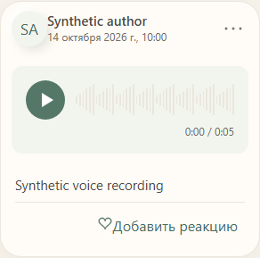
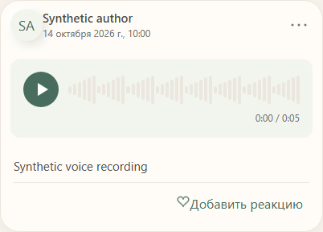

# MEMOLY-VOICE-PLAYER-MAX-LIKE

Статус: REVIEW — реализация и независимое техническое review завершены; передано владельцу через draft PR. Merge/deploy не выполнялись.

## Идентификация

- Base: `3abaaa1bcb5011a7cbd99d547f978fdefd5ca71e` (актуальный origin/main, повторный fetch подтверждён).
- Проверенный product/test commit: `597afbbfc6fbb4e9579de39fca6b2c3c4554c9d6`.
- Branch: `feat/memoly-voice-player-max-like`.
- Worktree: `D:/codex/TG_OurMemoriesDevBot/OurMemoriesDevBot/.worktrees/memoly-voice-player-max-like`.
- Lead: Codex / GPT-6; worker и независимый reviewer: `gpt-6-luna`, high (зафиксировано orchestration calls).
- Разрешённые production paths: `webapp/src/features/feed/FeedPage.tsx` (AudioPlayer/VoiceSeek), `webapp/src/features/feed/presentation/memoly-feed.css` (только voice styles).
- Остальные изменения: voice fixtures в `webapp/e2e/fixed-carousel.harness.tsx`, новый `voice-player.spec.ts` и его Playwright config; этот отчёт и два synthetic screenshot.

## Результат

Одна круглая кнопка 44×44 px переключает существующие WebP Play/Pause (24 px), не меняя размер. Доступные названия: «Воспроизвести голосовое» / «Приостановить голосовое»; видимых текстовых кнопок нет. После ended возвращается Play, повторное нажатие запускает аудио с начала.

Grid `44px minmax(0, 1fr)` держит кнопку слева от волны. Полоски растягиваются/сжимаются; время `текущее / общее` находится под волной, использует табличные цифры. Устранено переполнение audio wrapper из-за прежнего `width:100%` вместе с margin. На 320 и 430 px проверены общая линия центров кнопки/волны, время ниже, отсутствие переполнения, размер цели и компактная высота audio wrapper <=100 px.

Измеренные 48 peaks используются по-прежнему. Если peaks отсутствуют, показывается одна стабильная декоративная волна с тем же реальным прогрессом. Перемотку по нажатию/drag и с клавиатуры выполняет существующий native range поверх волны (высота hit area 44 px).

HTMLAudioElement, его event handlers, playback attempt guard, media coordinator и очистка ресурсов сохранены. Новых аудиообъектов, таймеров, глобальных менеджеров или зависимостей нет. Backend, MAX import, private media/auth, schema, миграции, контракты, фото, видео и карусели не менялись.

## Проверки

Все успешные проверки ниже относятся к тому же product source, что в `597afbb`; последующее дополнение отчёта/скриншотов не меняет код продукта.

| Команда | Результат |
|---|---|
| `bun install --frozen-lockfile` | 864 packages, exit 0; lockfile не изменён |
| `bun test ./webapp/tests/playback.test.tsx` | baseline 10/10, exit 0 |
| `bun run test:webapp` | 55/55, 275 assertions, exit 0; включает playback cleanup, exclusivity, errors и private media SW boundaries |
| `bun run lint` | exit 0 |
| `bun run typecheck:webapp` | exit 0 после штатного `bun run --cwd backend prisma:generate` |
| `bun run --cwd webapp tsc --noEmit -p tsconfig.e2e.json` | final fixture/type closure, exit 0 |
| `bun run --cwd webapp vite build` | 725 modules, exit 0 |
| `bun run architecture:check` | 695 source files, exit 0 |
| `bun run --cwd webapp playwright test --config e2e/voice-player.playwright.config.ts` | Chromium: 2/2, exit 0 |
| `bun run --cwd webapp playwright test --config e2e/voice-player.playwright.config.ts --browser webkit` | WebKit: 2/2, exit 0 с `VITE_API_URL=http://127.0.0.1:15201` и временным synthetic HTTP audio endpoint |
| `CI=1 bun run --cwd webapp playwright test --config e2e/fixed-carousel.playwright.config.ts` | существующий сценарий фото/видео, drag/fullscreen: 1/1, exit 0 |
| `git diff --check` | exit 0 |

Red/green: до реализации новый voice scenario падал на отсутствии доступной кнопки «Воспроизвести голосовое»; после изменения проходит. Тесты не проверяют исходный текст кода или случайную разметку: проверяются реальные media state, timer/progress и геометрия.

Browser scenarios проверяют Play→Pause, Pause→Play, native pointer seek и End с клавиатуры, прогресс/время, ended/replay, остановку первой записи при запуске второй, стабильную высоту, null-waveform, 320/430 px и light/dark OS preference. Page errors/console errors отсутствуют в успешных сценариях.

Первый дополнительный WebKit run: 1/2 (geometry pass, audio duration NaN). Native WebKit media requests обходят Playwright route mock и попадали на отсутствующий backend. Повтор с отдельным HTTP endpoint, отдающим только синтетический WAV с Range/206, прошёл 2/2; production код не изменялся. Endpoint остановлен после проверки. Это проверка клиентского поведения, не новая проверка production backend ACL/Range.

Свежий checkout изначально не имел generated Prisma client; его штатная генерация исправила typecheck dependency, схема и БД не изменялись. Ошибки fixture при подготовке не скрыты под syntax-only проверкой.

## Review

Один fresh independent read-only review GPT-6 Luna High по `3abaaa1..597afbb`: findings отсутствуют, P0/P1/P2 не обнаружены. Дополнительный whole-change review не запускался. Техническое review не является GitHub approval владельца и не разрешает deploy.

## Ограничения и передача

- Реальный iPhone Safari, MAX iPhone WebView, установленная PWA и Android не доступны в этой среде. Остаются ручные проверки touch drag/VoiceOver, background/resume и памяти ленты на этих устройствах.
- Desktop Chromium и WebKit проверялись на viewport 320/430 px, а не выдаются за физические устройства.
- В текущем UI v2 основной интерфейс имеет фиксированную светлую палитру (`color-scheme: only light`). Проверен также dark OS preference; отдельной dark palette приложение сейчас не предоставляет. Плеер наследует существующие semantic tokens, новая тема не добавлена.
- `bun run verify:local` не запускался: эта передача ограничена task branch/draft PR. Перед любым разрешённым merge необходимо выполнить полный gate в требуемом окружении на точном source SHA. GitHub Actions не вводились.
- Миграций/изменений API нет. Rollback: отмена UI commit через обычный отдельный PR; восстановления БД не требуется.
- Все материалы и авторы на скриншотах синтетические. Новые E2E fixtures не входят в production bundle.

## Визуальная приёмка

Кнопка слева, волна справа, время под волной; цвета memoLy UI v2 сохранены.

320 px / light OS preference:

430 px / dark OS preference, существующая светлая палитра:

